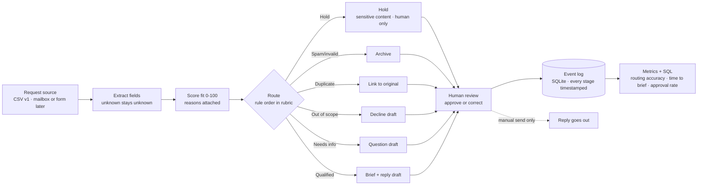

# Inbound Triage & Speed-to-Lead Engine

**Project type:** Self-directed systems build *(becomes "Live client pilot" only if a sponsoring company confirms scope, review, and publication terms)*
**Status:** v0.1 — brief, routing rubric, and labeled test set. No code yet.
**Author:** Cameron Castellon · [LinkedIn](https://www.linkedin.com/in/cameroncastellon/)

> From "a request email arrives" to "a qualified, routed, human-approved reply is ready," measured in minutes.

---

## The problem

Small B2B teams that take work requests by email or form lose time in the gap between *request arrives* and *the right person replies with the right next step*. Requests come in incomplete, duplicated, off-scope, or urgent, and nobody measures the gap. Published research on inbound response times keeps finding the same thing: most companies take hours or days to answer, and very few answer inside five minutes with something specific. The fix is not more effort; it is a system that triages every request the same way, prepares the reply, and leaves the decision with a human.

## The user

A founder or operations lead at a small B2B services company (10 to 50 requests a week) who personally reads the inbox. They need each request turned into a one-screen brief — who, what, which lane, what's missing, a drafted reply — fast enough to answer while the requester is still paying attention.

## What the engine does (v1 scope)

1. **Intake.** Reads requests from a CSV (v1). Later: a mailbox export or form webhook.
2. **Extract.** Requester, company or domain, request type (project / workflow / service), domain (legal, operations, engineering, sales, procurement, marketing, general), deadline, and the fields that are missing. Anything it cannot find is recorded as **unknown**, never guessed.
3. **Score fit** (0–100) against the written rubric, with reasons attached.
4. **Route** to exactly one lane: **Qualified · Needs info · Out of scope · Duplicate · Spam/invalid**, plus a **Hold** lane for requests that contain sensitive or privileged content. Flags (urgent, verify company) are added on top; they never change the lane.
5. **Draft** a reply from the lane's template, filling variables only from fields the request actually supplied. Every draft is marked DRAFT. Nothing sends itself.
6. **Human review.** The operator approves or corrects the lane and the draft. Corrections are logged, because they are the training signal.
7. **Log everything.** Every stage, flag, correction, and approval gets a timestamp in a small database (SQLite in v1; Postgres-compatible SQL throughout).
8. **Answer one operating question with SQL.** *By request type and final lane: how many requests, median minutes from arrival to approved brief, and first-pass approval rate?*

The rubric is in [`ROUTING_RUBRIC.md`](ROUTING_RUBRIC.md). The labeled test set is [`test_requests_v1.csv`](test_requests_v1.csv).

## Architecture

**Design rules carried through the build**

- Unknown is a valid value. A guessed company, title, or email costs more than a gap.
- The engine owns its own fields; the human owns the decision. They never write to the same column.
- Templates with variables, not free-written replies. About half of every draft is fixed text.
- A failed case stays in the bug log and is retested after the fix. Failures are part of the record.
- No scraping of personal data, no autonomous sending, no secrets in the repo (see `.gitignore`).

## Evidence labels

Every number in this project carries one of four labels, following the convention used across the portfolio:

| Label | Meaning |
|---|---|
| **Observed** | Happened in real production or shadow-mode use |
| **Tested** | Measured in a bounded test, including on fictional records |
| **Modeled** | Forecast from stated assumptions |
| **Planned KPI** | Chosen as the success measure, not yet measured |

A test run on fictional records can produce an *observed technical test result*. It cannot produce an observed customer or revenue outcome.

## KPIs (all **Planned KPI** as of v0.1)

| KPI | Definition | v1 target |
|---|---|---|
| Routing accuracy | Correct lane on the labeled set | ≥ 13 of 15 (v1) · ≥ 90% at 30 cases (v2) |
| Hold precision | Sensitive-content holds that were genuinely sensitive | 100% catch, no false holds on the word "confidential" alone |
| Missing-field detection | Incomplete requests correctly sent to Needs info | all incomplete cases |
| Duplicate detection | Resends linked to the original; new requests from the same sender not flagged | both cases correct |
| Time to approved brief | Arrival → operator approval, minutes | measured, then targeted |
| First-pass approval rate | Operator approves lane and draft without correction | measured, then targeted |
| Correction rate by lane | Corrections ÷ cases, per lane | measured, then targeted |
| Minutes saved per 100 requests | Modeled from Tested timings and stated volume assumptions | Modeled only |

## Independent work vs. client-dependent work

| I can finish alone | Needs a sponsoring company |
|---|---|
| Brief, rubric, labeled test set, extractor, scoring, routing, drafts, review flow, event log, SQL, metrics, write-up, walkthrough video | Shadow mode on real inbound · a real baseline (today's response time) · naming the company · any **Observed** number |

If a company confirms scope within five business days of being asked, the same engine runs in shadow mode on their inbound and results are labeled Observed. If not, the build completes on fictional records and is published as a self-directed systems build with Tested and Modeled results. Either outcome is a finished project.

## Roadmap

- **v0.1** (this commit): brief, rubric, 15-case labeled test set.
- **v0.2:** first script (Google Colab): load CSV → apply rubric rules → compare to expected → print accuracy by lane.
- **v0.3:** extractor with unknown-handling; fit score with reasons; drafts from templates; flags.
- **v0.4:** SQLite event log; review step with corrections; the SQL question; metrics table.
- **v0.5:** 30-case test set; bug log; retests; architecture diagram final; 4–6 minute walkthrough video; case page.
- **Shadow mode** (conditional): run on a sponsor's real inbound, Observed baseline vs. engine.

## Status log

- **2026-10-09** — Brief written. Rubric v1 with six lanes and two flags. Test set v1: 15 fictional requests, every lane covered, labels frozen for v1 after author review. No code yet.

---

*Fictional test data only. Company names, people, and emails in `test_requests_v1.csv` are invented; emails use reserved example domains. No real personal data appears anywhere in this repository.*
