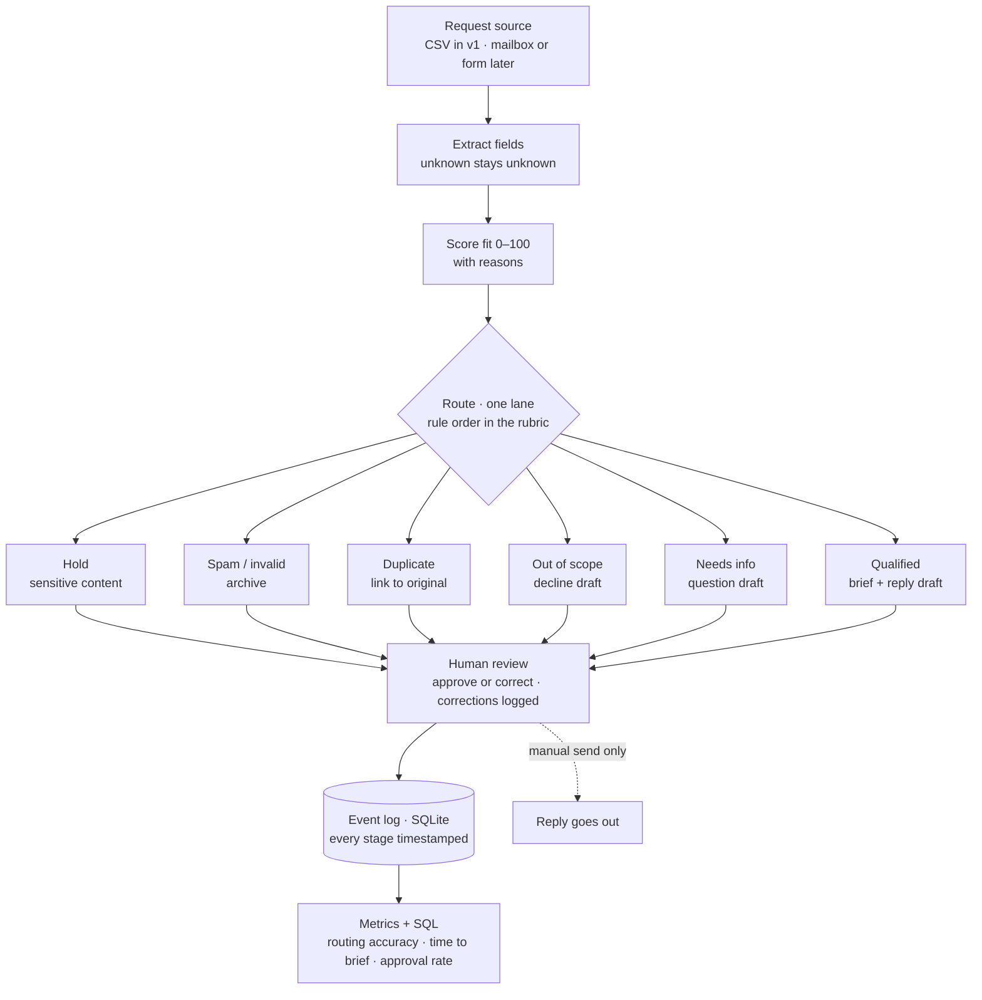

# Inbound Triage & Speed-to-Lead Engine

**v0.1** · built and tested on synthetic data first · first client implementation in scoping
**Cameron Castellon** · [LinkedIn](https://www.linkedin.com/in/cameroncastellon/)

> From "a request email arrives" to "a qualified, routed, human-approved reply is ready," measured in minutes.

---

## The problem

Small B2B teams that take work requests by email or form lose time in the gap between *request arrives* and *the right person replies with the right next step*. Requests come in incomplete, duplicated, off-scope, or urgent, and nobody measures the gap. Studies of inbound response times keep finding the same thing: most companies take hours or days to answer, and very few answer inside five minutes with something specific. The fix is not more effort; it is a system that triages every request the same way, prepares the reply, and leaves the decision with a human.

## The user

A founder or operations lead at a small B2B services company (10 to 50 requests a week) who personally reads the inbox. They need each request turned into a one-screen brief — who, what, which lane, what's missing, a drafted reply — fast enough to answer while the requester is still paying attention.

## What the engine does

1. **Intake.** Reads requests from a CSV (v1). Next: a mailbox export or form webhook.
2. **Extract.** Requester, company or domain, request type (project / workflow / service), domain (legal, operations, engineering, sales, procurement, marketing, general), deadline, and the fields that are missing. Anything it cannot find is recorded as **unknown**, never guessed.
3. **Score fit** (0–100) against a written rubric, with reasons attached.
4. **Route** to exactly one lane: **Qualified · Needs info · Out of scope · Duplicate · Spam/invalid**, plus a **Hold** lane for requests that contain sensitive or privileged content. Flags (urgent, verify company, language) are added on top; they never change the lane.
5. **Draft** a reply from the lane's template, filling variables only from fields the request actually supplied. Every draft is marked DRAFT. Nothing sends itself.
6. **Human review.** The operator approves or corrects the lane and the draft. Corrections are logged, because they are the training signal.
7. **Log everything.** Every stage, flag, correction, and approval gets a timestamp in a small database (SQLite in v1; Postgres-compatible SQL throughout).
8. **Answer one operating question with SQL.** *By request type and final lane: how many requests, median minutes from arrival to approved brief, and first-pass approval rate?*

The rubric is in [`ROUTING_RUBRIC.md`](ROUTING_RUBRIC.md). The reasoning behind each design choice is in [`DECISIONS.md`](DECISIONS.md). The v1 test set is [`test_requests_v1.csv`](test_requests_v1.csv).

## Architecture

**Design rules carried through the build**

- Unknown is a valid value. A guessed company, title, or email costs more than a gap.
- The engine owns its own fields; the human owns the decision. They never write to the same column.
- Templates with variables, not free-written replies. About half of every draft is fixed text.
- A failed case stays in the bug log and is retested after the fix. Failures are part of the record.
- No scraping of personal data, no autonomous sending, no secrets in the repo.

## How it's being built: synthetic data first, then live

1. **Build and test on a synthetic request set** (now). Fifteen requests written to cover every lane and the edge cases that break naive routing: a resend versus a genuinely new request from the same sender, a free-mail sender with a real business ask, a non-English request, the word "confidential" versus actually confidential content. Routing accuracy against this set is the first measured result, and the set becomes the regression test for every later change.
2. **Shadow mode with a client.** The engine runs beside the human reader on live inbound. Nothing changes for requesters. The engine's lanes and drafts are compared with what the human actually did, and the gap between arrival and first substantive reply is measured for real.
3. **Assisted mode.** The operator approves engine drafts. Time to approved brief, first-pass approval rate, and correction rate are measured live.

## How numbers are labeled

Every number in this project carries one of four labels, so a reader knows how it was measured:

| Label | Meaning |
|---|---|
| **Observed** | Measured in live use (shadow or assisted mode) |
| **Tested** | Measured in a bounded test on the synthetic set |
| **Modeled** | Projected from stated assumptions |
| **Planned KPI** | Chosen as the success measure; not yet measured |

## Measurement plan

| Measure | Definition | Target | Status |
|---|---|---|---|
| Routing accuracy | Correct lane on the labeled set | ≥ 13 of 15 (v1) · ≥ 90% at 30 cases (v2) | Planned KPI |
| Hold precision | Holds that were genuinely sensitive | 100% catch, no false holds on the word "confidential" alone | Planned KPI |
| Missing-field detection | Incomplete requests correctly sent to Needs info | all incomplete cases | Planned KPI |
| Duplicate detection | Resends linked to the original; new requests from the same sender not flagged | both cases correct | Planned KPI |
| Time to approved brief | Arrival → operator approval, minutes | measured, then targeted | Planned KPI |
| First-pass approval rate | Operator approves lane and draft without correction | measured, then targeted | Planned KPI |
| Correction rate by lane | Corrections ÷ cases, per lane | measured, then targeted | Planned KPI |
| Minutes saved per 100 requests | From Tested timings and stated volume assumptions | — | Modeled |

## Roadmap

- **v0.1** — brief, rubric, 15-case labeled test set. *(this release)*
- **v0.2** — first rules engine: load the test set, apply the rubric in order, report accuracy by lane.
- **v0.3** — field extraction with unknown-handling; fit score with reasons; drafts from templates; flags.
- **v0.4** — SQLite event log; review step with corrections; the SQL question; metrics table.
- **v0.5** — 30-case test set; bug log; retests; walkthrough video; case page.
- **Client implementation** — shadow mode, then assisted mode, on live inbound; Observed baseline versus engine.

## Status log

- **2026-10-09** — Brief written. Rubric v1: six lanes, three flags, fixed rule order. Test set v1: 15 requests, every lane covered; labels frozen after author review.
- **2026-10-12** — README reframed around the synthetic-first rollout. `DECISIONS.md` added with the reasoning behind each design choice. First client implementation entered scoping.
